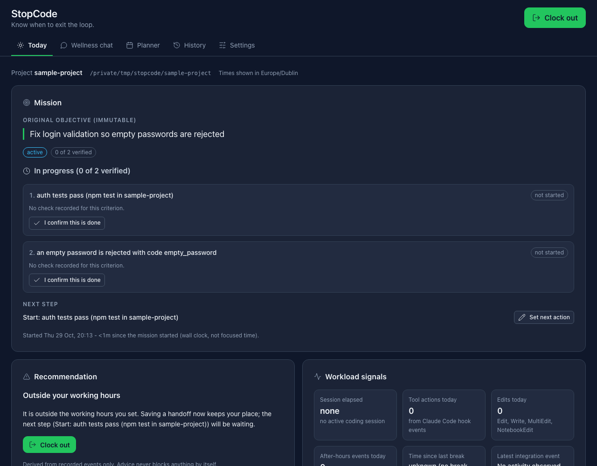

# StopCode

**Know when to exit the loop.** AI helps you code faster; StopCode helps you know when to stop.

A Claude Code plugin plus a local dashboard that keeps your original goal visible, shows your
workload from real hook activity, parks unfinished work in an honest handoff, and protects the
recovery time you choose.

## At a glance

- **Which idea:** **A shutdown command.** `/stopcode:finish tomorrow --protect` is one command
  that saves your open work as a handoff (goal, verified criteria, changed files and Git state;
  a written record, not a commit or stash),
  writes tomorrow's list (next action, unverified criteria, parked ideas) and pauses Claude Code
  in that project until your next working morning. It also covers part of **a workload tracker**:
  the dashboard shows tool actions, edits, after-hours activity and when you last recorded a
  break, from Claude Code hook events.
- **Who it's for:** developers who code with an AI assistant (Claude Code) and found that faster
  tools made their days longer, not shorter: they keep taking "one more task", and they find it
  hard to put down half-finished AI-assisted work at the end of the day.
- **Why it helps:** compression burnout has two engines. The goal quietly expands, and stopping feels
  like losing your place. StopCode works on both inside the tool where the work happens: it holds
  your original goal and parks extra ideas, and it turns stopping into one command that saves a
  handoff and, if you want, protects your evening.
- **How it gives time back:**
  - *Stopping costs one command.* `/stopcode:finish` (or **Clock out** in the dashboard) writes
    the handoff for you: original goal, which criteria are verified, files and Git state, parked
    ideas, next action. The next day every new Claude Code session starts with the goal, the
    next step, parked ideas and the handoff already in Claude's context, so you don't spend the
    start of the day re-explaining where you were.
  - *Scope creep gets parked, not done tonight.* "While you're at it" ideas go on a list for later.
  - *Your evening stays yours.* Opt-in quiet hours block new Claude Code actions in that project
    until the time you chose, so a "quick fix at 11 pm" doesn't happen on autopilot.
- **What it doesn't add:** no notifications, pop-ups, badges, streaks or scores. Apart from
  stating your goal once (`/stopcode:start`), activity is captured automatically from Claude Code
  hooks; there is nothing to log by hand. By default the only nudge is a short note in *Claude's*
  context when a prompt looks like scope creep, at most once every 20 minutes. Reminders after
  3 hours or outside working hours are off unless you turn them on; all advice can be turned off
  in Settings.
- **Daily use is two commands:** `/stopcode:start <goal>` when you begin, `/stopcode:finish`
  when you stop. The dashboard, wellness chat and planner are optional extras; you never have to
  open them.

### Try it in a minute

```bash
git clone https://github.com/CG-5228/ClaudeCodeImpactLab_hackathon.git stopcode && cd stopcode
npm install
npm run try                             # the whole loop end to end in ~1 s (see below)
npm test                                # 27 tests, no network or API key needed
npm run demo -- --reset --seed          # sample data + dashboard at http://127.0.0.1:4821
```

`npm run try` needs neither Claude Code nor an API key. It drives the real CLI and the real hook
script with the same JSON Claude Code sends, in a throwaway directory, and checks what was
actually stored: goal recorded and injected into Claude's context, scope creep noticed and the
idea parked, failing then passing `npm test` captured as evidence, the shutdown command (handoff
plus tomorrow's list, Claude Code paused until the next working morning), a late-night tool call
and prompt blocked, resume refused until an explicit override, and the next session starting with
the goal, next step and parked ideas already in Claude's context.
It ends with `Summary: 13 passed, 0 failed.`



Then use it in your own projects. Install it once and it is available in every project:

```bash
# inside Claude Code (one step, Claude Code 2.1.275 or later):
/plugin install stopcode --marketplace CG-5228/ClaudeCodeImpactLab_hackathon
# or from a terminal:
claude plugin marketplace add CG-5228/ClaudeCodeImpactLab_hackathon
claude plugin install stopcode@stopcode
# or without installing, from your clone:
claude --plugin-dir "/absolute/path/to/stopcode"
```

The hooks, skills and CLI have no dependencies; `npm install` is only needed for the optional
wellness chat. Then, inside Claude Code:

```text
/stopcode:start Fix the login bug       record the goal
/stopcode:finish tomorrow --protect     the shutdown command: handoff + tomorrow's list,
                                        Claude Code paused in this project until morning
/stopcode:resume                        tomorrow: pick up exactly where you stopped
```

## The problem: compression burnout

AI compresses work. A task that took an afternoon now takes an hour, so the afternoon fills with
two more tasks. The original goal quietly expands ("while you're at it…"), the day gets longer,
and the gains in speed turn into gains in volume rather than time back.

Stopping also got harder. Half-finished AI-assisted work is hard to put down: the context lives in
a conversation, the next step is in your head, and closing the laptop feels like losing your
place. So you keep going. StopCode is built for the developer in that loop.

## What StopCode does

1. **Workload and recovery dashboard** — the original mission and its completion criteria,
   verification evidence, elapsed wall-clock time, after-hours activity and recorded breaks, all
   derived from real Claude Code hook events. One primary action: **Clock out**.
2. **Wellness chat** — a separate assistant (Claude API through the local backend, its own
   conversation history and system prompt, never your Claude Code conversation) that helps you
   stop, park ideas and plan recovery. Its suggestions are buttons; nothing happens until you click.
3. **Calendar planner** — working hours, breaks, recovery blocks and personal time, with
   overlap detection and `.ics` export.
4. **Claude Code plugin** — hooks and skills (`/stopcode:start`, `status`, `pause`, `finish`,
   `resume`) that record the goal, capture bounded activity, save handoffs, and enforce opt-in quiet
   hours deterministically.

Core promise: **"I can stop without losing my place."**

## Honest by design

- **What it measures:** elapsed wall-clock time between recorded events, and the hook events
  themselves (tool calls, edits, commands, prompts, test/build runs). That is all.
- **What it never claims:** focus time, rest, hours saved, burnout scores, streaks. "Time since last
  break" is *unknown* until you record a break. Elapsed time is always labelled elapsed.
- **Completion is evidence-based.** "Your original goal is complete" appears only when every
  criterion has passing evidence attached. A user's "it's done" is recorded as a *user
  confirmation*, labelled separately from verification. A file edit is never evidence.
- **Configuration is not connection.** An API key being set and a successful test call are shown
  separately; the integration line shows the last real hook event or "No activity observed yet".
- **Advice is advisory.** Hook-injected nudges are rate-limited, dismissible and never block.
  Enforcement (quiet hours) is a separate, explicit opt-in per project, and the StopCode CLI stays
  usable during it.
- **API failure never blocks** clocking out, saving a handoff or scheduling. No telemetry. The
  dashboard makes no external requests; only the chat backend calls the Claude API.

## Quick start

Requirements: Node >= 22, Claude Code 2.1.308 or newer (tested on 2.1.308 on macOS and 2.1.312 on
Windows 11), Git (optional, used for project roots and handoff Git state).

```bash
git clone https://github.com/CG-5228/ClaudeCodeImpactLab_hackathon.git stopcode && cd stopcode
npm install                       # single dependency: @anthropic-ai/sdk (wellness chat only)
claude plugin validate .          # checks .claude-plugin/plugin.json, hooks/ and skills/
```

Load the plugin in **any** project (quotes make paths with spaces work; hooks are declared with
an args array, so `${CLAUDE_PLUGIN_ROOT}` with spaces is fine too):

```bash
cd ~/code/my-project
claude --plugin-dir "/absolute/path/to/stopcode"
```

Start the dashboard (binds to 127.0.0.1 only):

```bash
npm start                         # http://127.0.0.1:4821   (--port / STOPCODE_PORT to change)
```

### Wellness chat setup (separate, optional)

The chat calls the Claude API from the dashboard backend. Provide credentials to the **server**
only; they never reach the browser, the logs or the state files.

```bash
cp .env.example .env              # then set ANTHROPIC_API_KEY=sk-ant-...   (.env is git-ignored)
# or: export ANTHROPIC_API_KEY=sk-ant-...
# model: STOPCODE_CHAT_MODEL (default claude-opus-5-5)
```

A Claude Code subscription does **not** provide API credentials; you need an API key from the
Anthropic Console. Without one the chat shows a configuration-required state; everything else
works. Settings → *Test connection* performs a real call and records the result; until then the
dashboard says "configured, not tested".

## Claude Code skills

| Skill | What it does | Does not |
| --- | --- | --- |
| `/stopcode:start <goal>` | Records the original objective and 2–4 practical completion criteria; begins tracking. | Start the work. |
| `/stopcode:status` | Mission, criteria with evidence, next step, elapsed (wall clock), breaks, quiet/monitoring state, integration line. Can record evidence for checks Claude actually ran. | Call anything complete without evidence. |
| `/stopcode:pause` | Pauses activity capture and advice for this project. | Close Claude Code, block coding, or lift quiet hours. |
| `/stopcode:finish [30m\|2h\|until HH:MM\|tomorrow] [--protect] [--complete] [note]` | Saves a handoff, logically ends the tracked session, parks the mission, optionally starts quiet hours (asks one question if unclear). Reports each part separately. | Require the mission to be complete; claim you rested. |
| `/stopcode:resume [--override]` | Restores the latest handoff; if quiet hours are active, asks for an explicit yes before overriding. | Start implementing anything. |

Scope changes are recorded instead of silently absorbed: `stopcode scope accept "<text>"` for an
accepted addition (the original objective stays immutable), `stopcode idea add "<text>"` to park
an idea for later.

## Privacy, quiet hours and the rest, in short

- **Local only.** Everything is stored in `~/.stopcode` on your machine. No telemetry. Stored:
  short redacted excerpts (prompts <= 120 chars, commands <= 100 chars), project-relative file
  paths, tool names, timestamps, test summaries and what you type into StopCode. Never stored:
  file contents, full prompts, transcripts, API keys. The only outbound call is the optional
  wellness chat to the Claude API, from the local backend, with your key.
- **Quiet hours cover one project and only Claude Code's actions in it.** Your editor, terminal,
  other projects, the dashboard and the StopCode CLI keep working. Without `--protect` they are
  advisory only. Lifting them is always one explicit step (`/stopcode:resume` then yes, or
  `stopcode resume --override`), and the override is recorded.
- **Hooks fail open.** Any internal error is logged and shown as DEGRADED in the dashboard and
  `stopcode doctor`; a hook never blocks Claude Code because StopCode broke.
- **Everything works without the dashboard:** `node bin/stopcode.js help` lists the full CLI.

Full details: [docs/REFERENCE.md](docs/REFERENCE.md) (CLI, every hook event, quiet-hours scope,
storage layout, planner `.ics` limits, wellness chat consent).

## Uninstall

```bash
node bin/stopcode.js uninstall                      # ends active quiet hours, prints the steps
node bin/stopcode.js uninstall --purge-data --yes   # also deletes the data directory
```

Then stop passing `--plugin-dir` (or `claude plugin uninstall stopcode@stopcode` if you
installed it from the marketplace). StopCode writes only to its data directory; the plugin modifies
nothing else on your machine.

## Demo

`docs/DEMO.md` is the eight-step live demo (real Claude Code, a real 2-minute boundary, a tiny
sample project with one deliberate bug). `npm run demo -- --reset --seed` prepares an isolated
data directory, prints every command with absolute paths, and starts the dashboard.
`docs/ARCHITECTURE.md` explains the moving parts; `docs/API.md` is the local API contract.

## Testing

```bash
npm run try                       # end-to-end walkthrough against the real CLI and hook script
npm test                          # node --test tests/
cd sample-project && npm test     # the demo fixture: fails 1 of 4 until the deliberate bug is fixed
claude plugin validate .
```

The suite under `tests/` (27 tests) covers: scope decisions, the completion state machine and
evidence parsing (`core.mission`); project identity, Git roots and symlinked paths
(`core.projects`, `hooks.quiet`); atomic storage, backup recovery and cross-process locking
(`core.store`); advice defaults (`hooks.quiet`); and the real hook script spawned with Claude Code-shaped stdin during protected
quiet hours, the CLI allowlist, resume exit code 3 / `--override`, fail-open behaviour and `.ics`
linting (`hooks.quiet`); and `npm run try` itself (`try`). Not covered by automated tests: the HTTP API, the wellness chat, the
dashboard UI and handoff Markdown rendering (exercised manually, see `docs/VERIFICATION.md`).

### Verification status

- **Verified with real Claude Code:** Claude Code 2.1.312 on Windows 11 (2026-10-29) via
  `scripts/live-check.sh` (11 passed, 0 failed): all six hook events, `/stopcode:status`, the
  advisory note, a PreToolUse deny and a blocked prompt during protected quiet hours,
  `/stopcode:resume` asking before overriding, `/stopcode:resume --override`. Details in
  `docs/VERIFICATION.md`.
- **Verified with fixtures / CLI only:** on macOS (Claude Code 2.1.308, Node v24.21.0,
  2026-10-29): `npm test` 27/27, `claude plugin validate .`, sample project fails 1 of 4 as
  intended, CLI start/status/finish/export through a symlinked path (`/tmp`).
  `scripts/live-check.sh` was also re-run with real Claude Code 2.1.308 on macOS: 11 passed,
  0 failed (model `claude-sonnet-5-5`).
- **Not verified:** the wellness chat against the real Claude API (no API key was available);
  calendar sync (not implemented).

## Known gaps

- No Google/Outlook/CalDAV sync; `.ics` export only.
- Quiet hours cover the Claude Code integration only (this plugin's hooks). Your editor, terminal,
  browser and other AI tools are untouched; a command already running is not cancelled.
- Evidence parsing recognises common runner summaries only (TAP `# pass/# fail`, Node's spec
  reporter `ℹ pass/ℹ fail`, Jest/pytest-style
  `N passed`/`N failed`, cargo, Go `--- FAIL`, generic `N errors`). Anything else is recorded as
  `unknown`, never as `pass`.
- The wellness chat needs an Anthropic API key (a Claude Code subscription does not provide one).
- Session end is best effort: if Claude Code is killed, SessionEnd may not fire and elapsed time
  can overstate until the session is flagged stale (2 h without events). Elapsed time is time
  between events, not attention.
- Project identity is the Git top level, so a monorepo is one project. The sample project in this
  repository therefore registers as the repository itself unless the demo seed pins it.
- Secret redaction is pattern-based and best effort; do not paste credentials into prompts.
- Single user, single machine, no authentication on the local server (it binds to 127.0.0.1 and
  requires a custom header plus a same-origin check for every mutation).
- The handoff documents observed state; it is not a backup of unsaved editor buffers and it does
  not commit or stash for you.
- `--until tomorrow` needs configured working hours (default Mon–Fri 09:00–17:30 in the system
  time zone; change them in Settings).

## License

MIT — see `LICENSE`.
